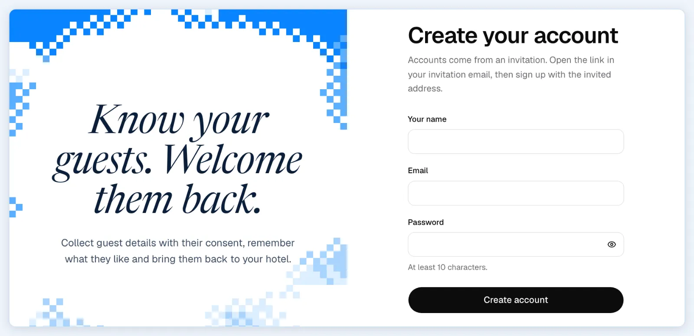
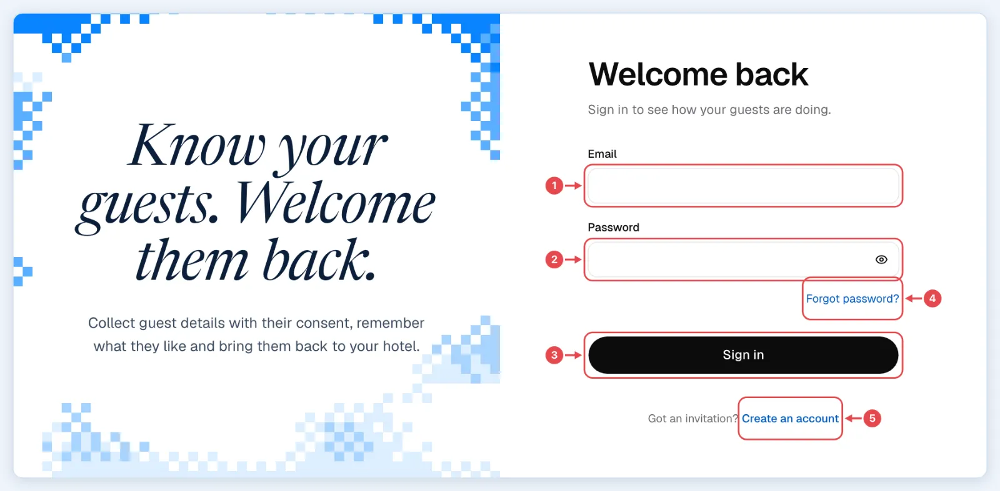
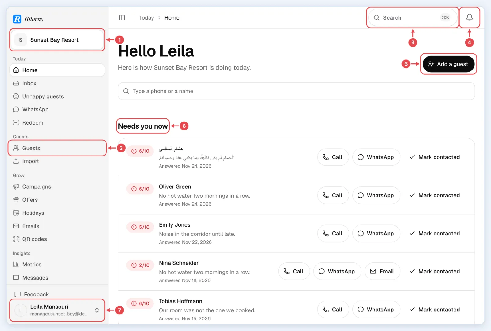
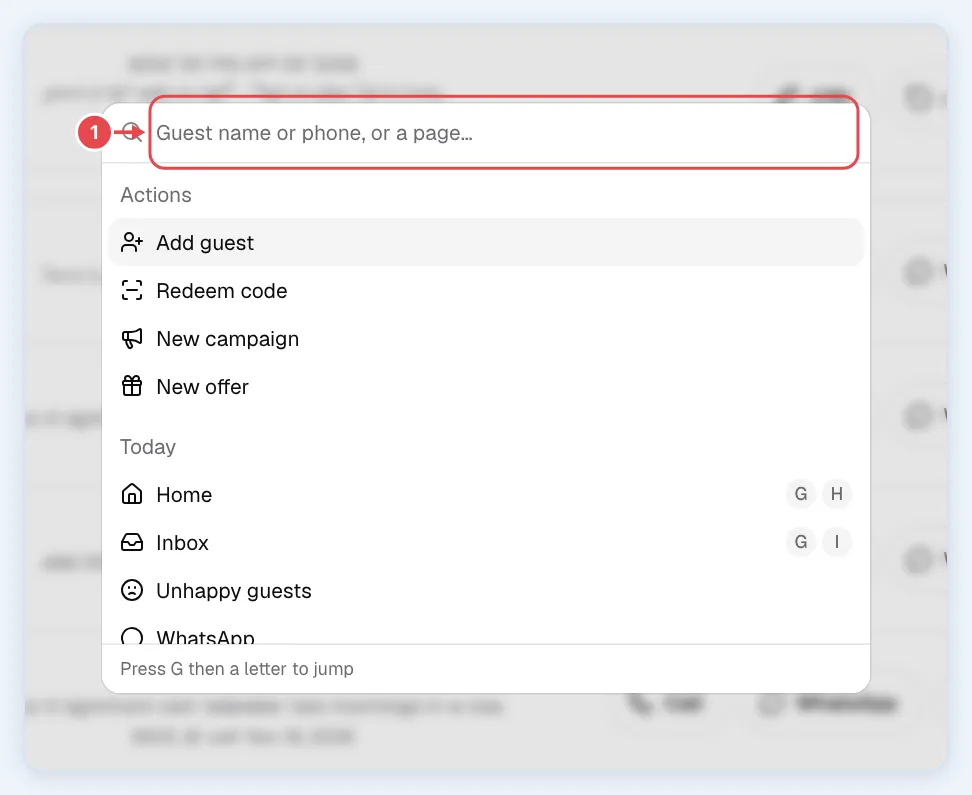
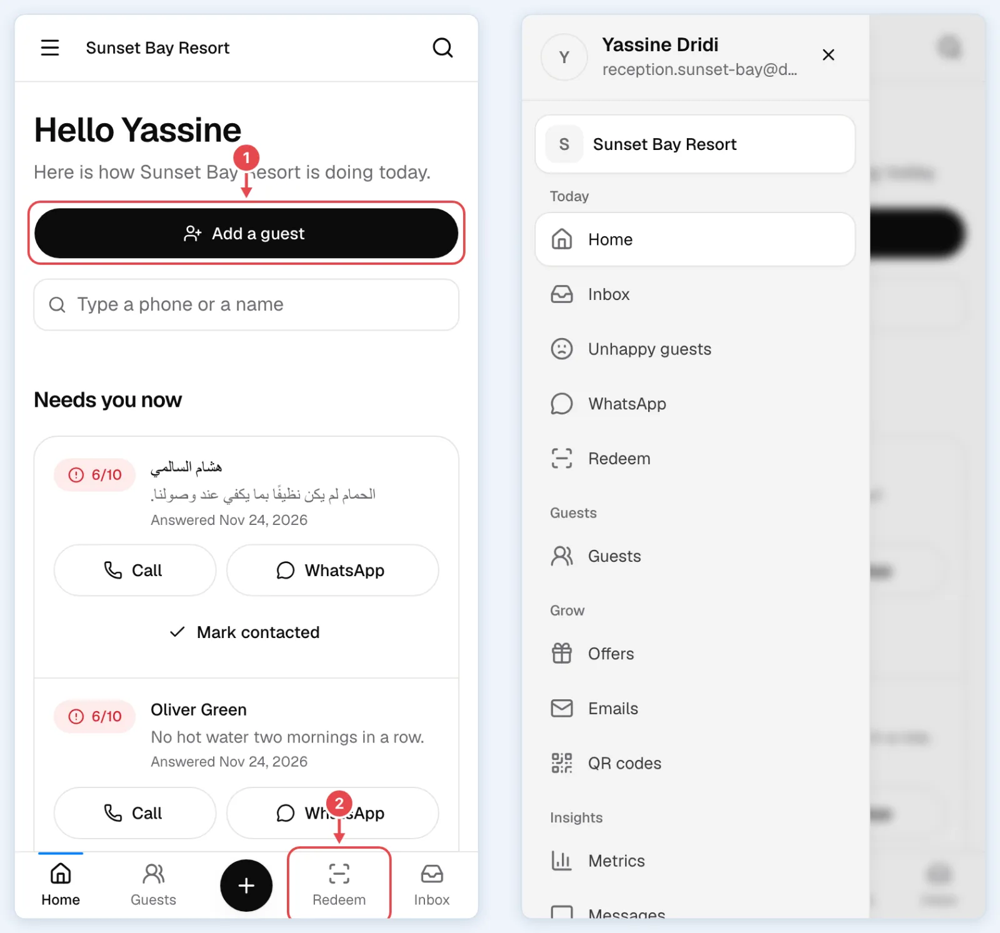
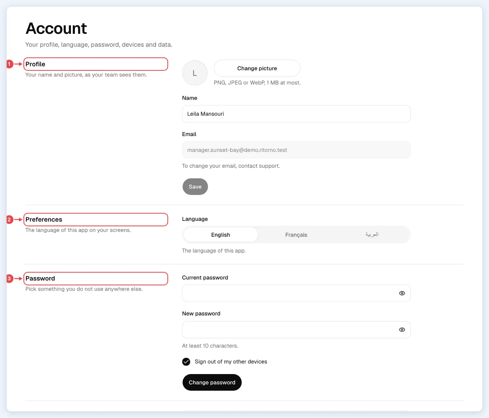

## Create your account

Someone from your hotel sends you an invitation by email. Open its link, create an account with **the same email address**, and choose a password of at least 10 characters. The invitation stops working after the date shown in the team list, so ask for a new one if yours has expired.

## Sign in

1. Your email address.
2. Your password. The eye shows what you typed.
3. **Sign in**.
4. **Forgot password?** emails you a link to choose a new one. It works once, for one hour.
5. **Create an account** is only for people with an invitation.

On a shared computer, sign out when you leave: open your name at the bottom of the menu and choose **Sign out**.

## Find your way around

1. The hotel you are working in. If you belong to several hotels, switch here.
2. The menu. **Today** is daily work, **Guests** is your list, **Grow** is offers and messages, **Insights** is results.
3. **Search**: a guest by name or phone, or any page.
4. Notifications: notes and alerts about your hotel.
5. **Add a guest**.
6. **Needs you now**: guests who left a low score. Start your shift here.
7. Your account: language and sign out.

Home also shows the last 7 days (new guests, returning guests, survey score, offers redeemed), the latest guests, and the link to your guest sign-up page.

## Search from anywhere

Press `Ctrl K` (`⌘K` on a Mac) or select **Search**.

1. Type part of a name, a phone number or a page name. The shortcuts under **Actions** open the common tasks. Pressing `G` then a letter also jumps to a page, for example `G` then `R` for Redeem.

## On a phone or tablet

Everything works on a phone. The bar at the bottom holds the daily tasks and the menu button at the top opens the rest.

1. **Add a guest**.
2. **Redeem** an offer.

## Your language and password

Open your name at the bottom of the menu, then **Account**.

1. **Profile**: your name and picture, as your team sees them.
2. **Preferences**: the language of the app for you only. It does not change what guests receive.
3. **Password**: change it, and sign out your other devices at the same time.

Further down the page you can see where you are signed in, download your own data or delete your account.

## If something is wrong

Use **Feedback** at the bottom of the menu to tell the Ritorno team. What you send is posted publicly, so never put a guest's name or number in it.

Next: [the front desk](/docs/guide/front-desk).
