## What the guest does with a QR code

The guest scans the code with their phone camera. There is no app to install. They pick a language, type their name and phone number, and switch on WhatsApp or email only if they want to. Then they see their welcome offer as a code to show you.

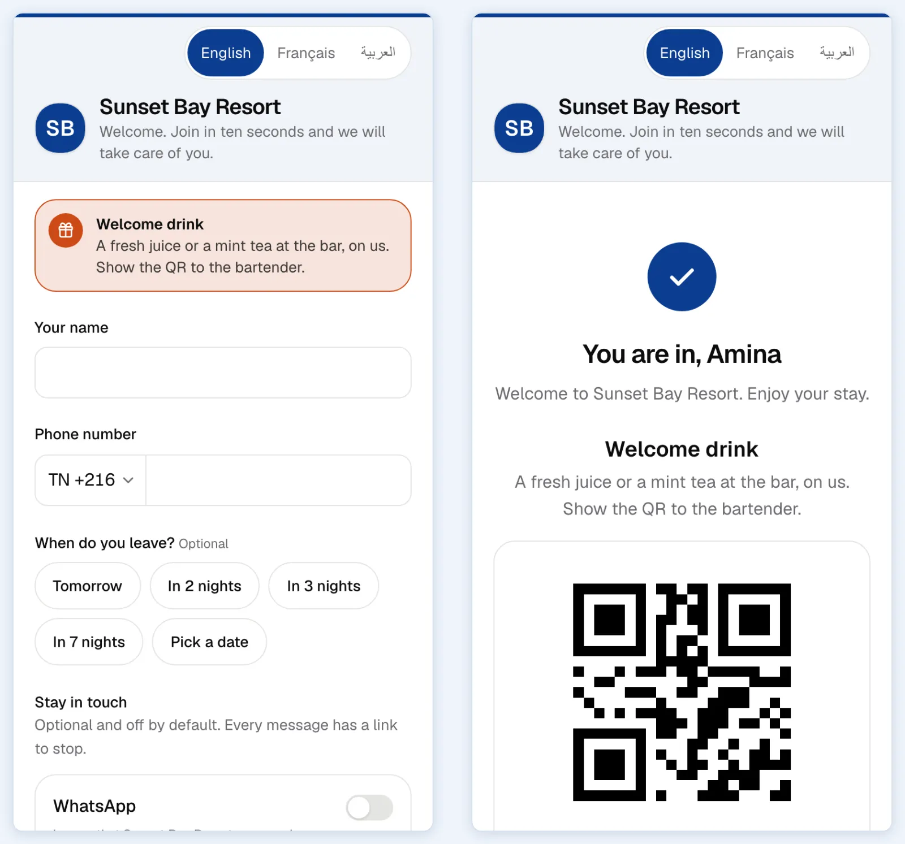

If they cannot or will not scan, add them yourself.

## Add a guest

Select **Add a guest** on Home or in Guests.

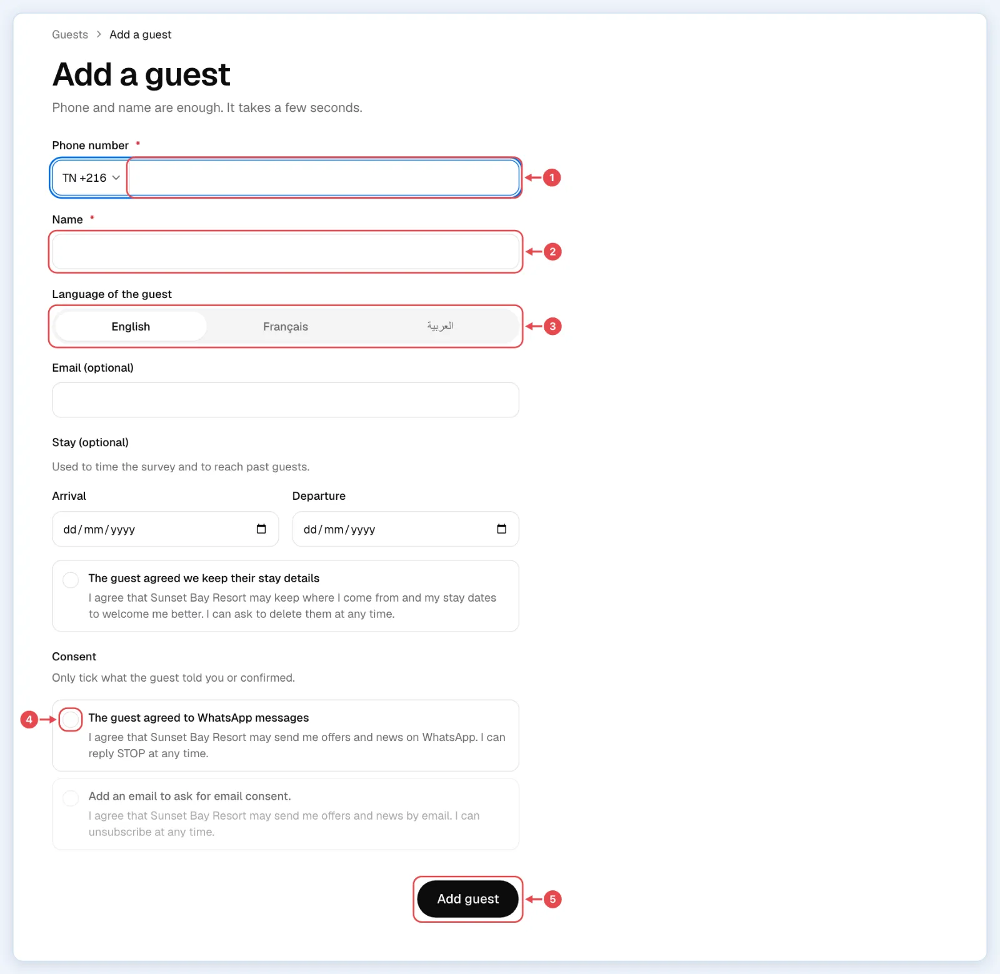

1. Phone number. Pick the country first if it is not Tunisia.
2. Name.
3. The language the guest wants to be written in.
4. Consent. Ask the question out loud, for example "may we send you offers on WhatsApp?". Tick only on a yes. Email consent needs an email address.
5. **Add guest**.

Arrival and departure dates are optional. They are only saved when the guest agrees you keep them, and the departure date decides when the stay survey goes out. The form is then empty again, ready for the next person.

### The guest is already known

As soon as you type a known number, Ritorno tells you whose it is.

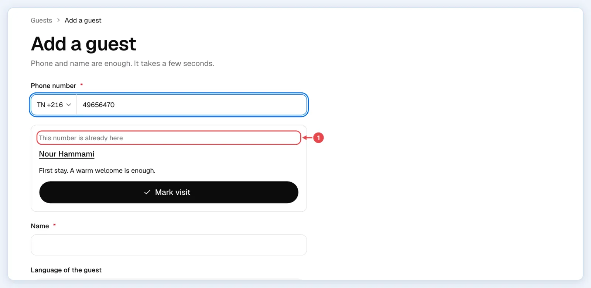

1. The guest is already on your list. Open their name to see their history, or select **Mark visit** to record that they are here today.

Saving the form again never creates a second copy. It only fills gaps and adds consent, and it never gives back a consent the guest withdrew.

## Find a guest

Open **Guests**.

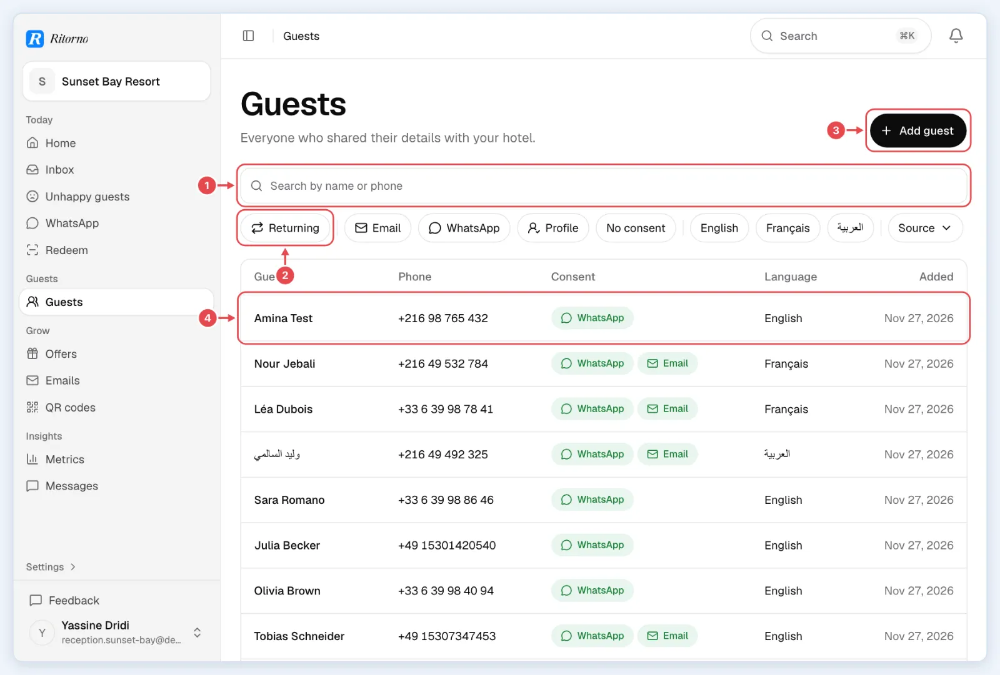

1. Search by name or phone number.
2. Filters: returning guests, what they agreed to, their language and how they joined.
3. **Add guest**.
4. A row opens the guest's profile.

## The guest profile

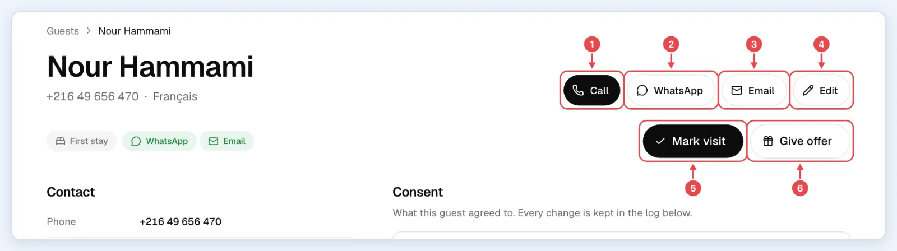

1. **Call** the guest.
2. Open a **WhatsApp** chat with them.
3. Write an **Email**.
4. **Edit** their details, for example a new number or the departure date.
5. **Mark visit**, once a day at most.
6. **Give offer**.

**Call**, **WhatsApp** and **Email** open your own phone or mail app. Only use them to help the guest. Offers and news go through Ritorno, which respects what they agreed to. Lower on the page are their stays, the offers they used, their survey answers and the messages they received.

### When a guest says stop

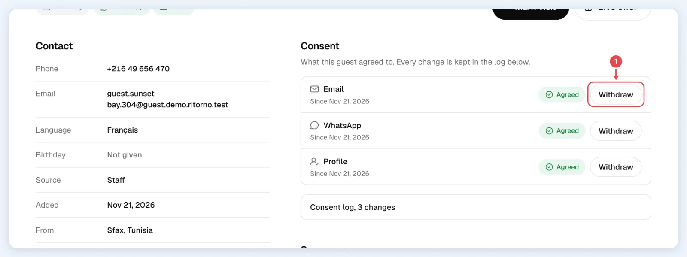

1. **Withdraw** next to the channel the guest no longer wants. Every change is kept in the consent log. Guests can also reply STOP on WhatsApp or use the unsubscribe link in an email.

## Give an offer

On the profile, select **Give offer** and pick one.

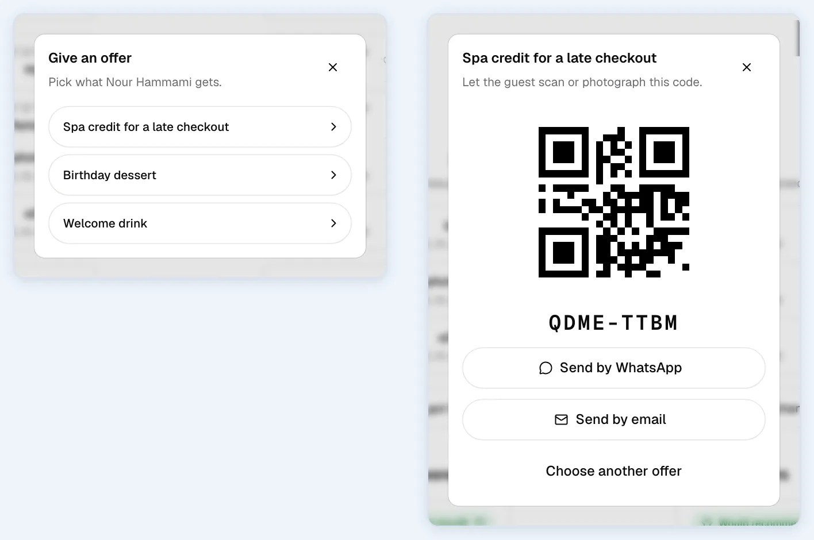

Let the guest scan or photograph the code, or send it by WhatsApp or email if they agreed to that channel. If no offer appears, ask your manager to create one.

## Redeem an offer

Open **Redeem** when a guest shows a code.

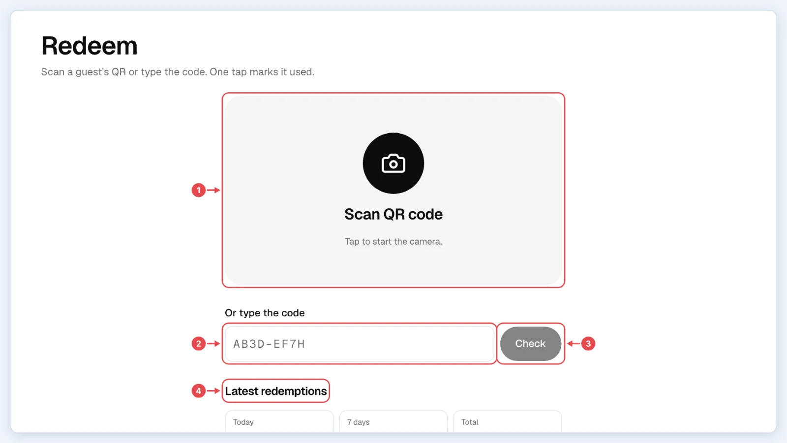

1. **Scan QR code** with the camera of your phone or tablet. Allow the camera when asked.
2. Or type the code.
3. **Check**.
4. What was redeemed lately.

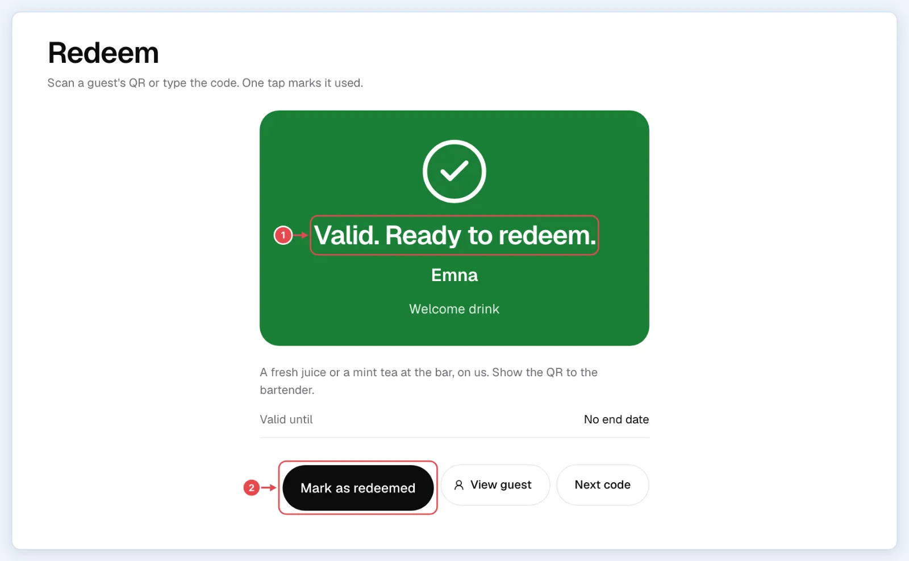

1. Read the result first. Only a green **Valid. Ready to redeem.** may be honoured.
2. Serve the guest, then **Mark as redeemed**. Tapped by mistake? Use **Undo**.

| The screen says | What to tell the guest |
| --- | --- |
| Already redeemed | It was used before. The screen shows when and by whom. |
| Expired | The offer has ended. |
| Not valid yet | Ask them to come back from the start date. |
| This offer is paused, or no redemptions left | Nothing can be redeemed. Tell your manager. |
| This code belongs to another hotel | Ask for the code your hotel sent. |
| Code not found | Check the letters and try again. |

## Unhappy guests

A guest who gives a low score in the stay survey appears in **Unhappy guests** and under **Needs you now** on Home. Try to contact them the same day.

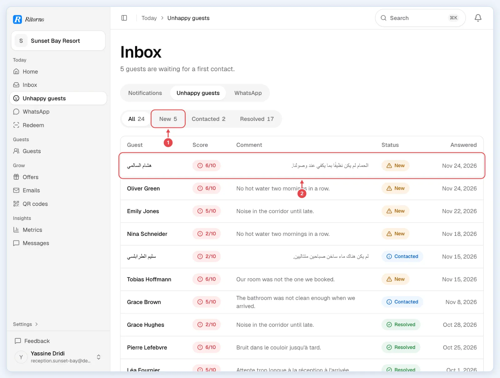

1. **New** shows the guests nobody has contacted.
2. Open a row to see the whole answer.

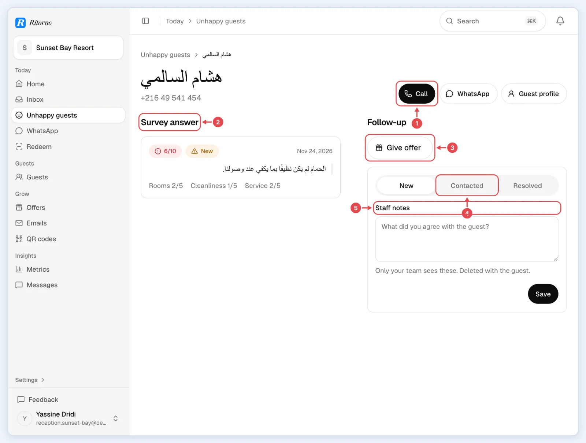

1. **Call** or write to the guest.
2. Their score and comment. Read it before you call.
3. **Give offer** if you want to make it up to them.
4. Move the case to **Contacted**, then **Resolved**.
5. **Staff notes**: what you agreed. Only your team sees them. Select **Save**.

## WhatsApp scans and notifications

- **WhatsApp** lists guests who scanned a code and chose to continue on WhatsApp. You see their number and the spot, not what they wrote. Offer help only: it is not a consent to marketing. Entries are removed after 30 days. The list stays empty when your hotel does not use this option.
- **Inbox** holds notes from the Ritorno team and alerts about your hotel.

## On the desk phone

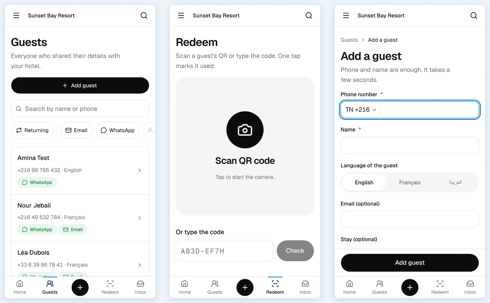
