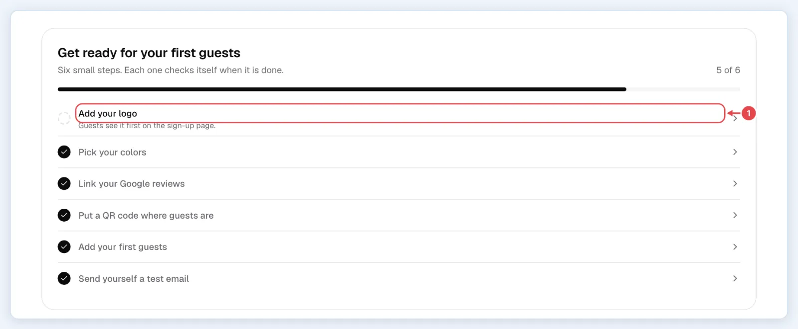
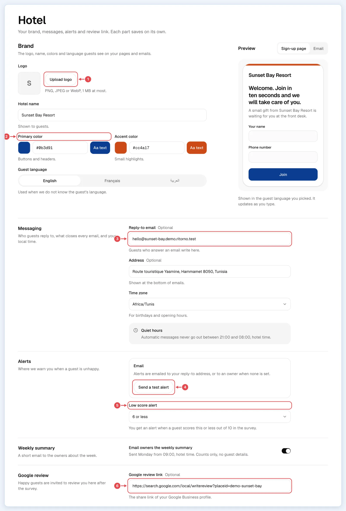
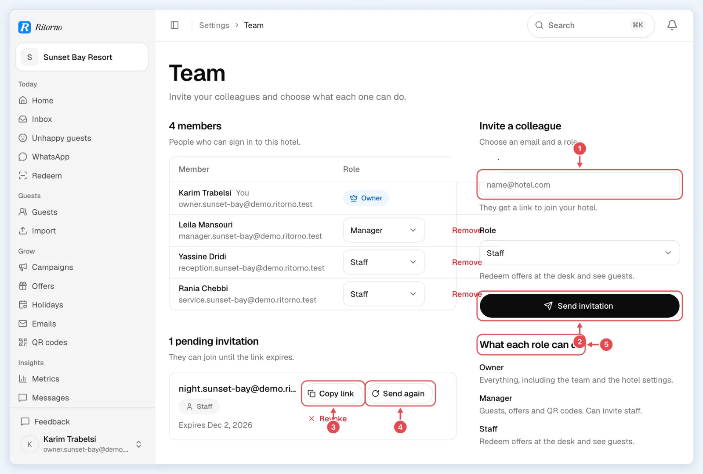
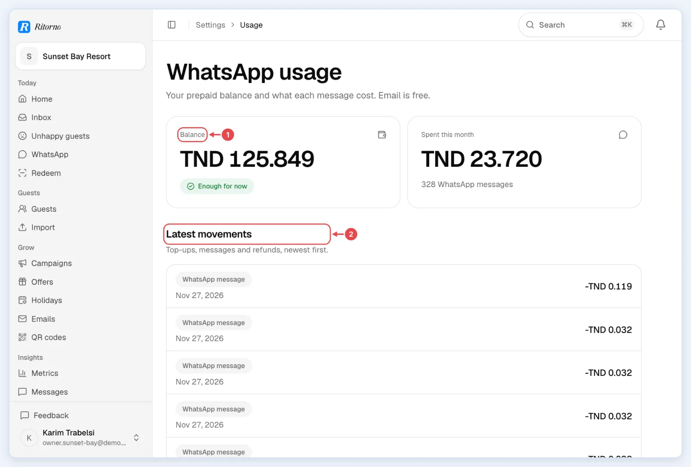
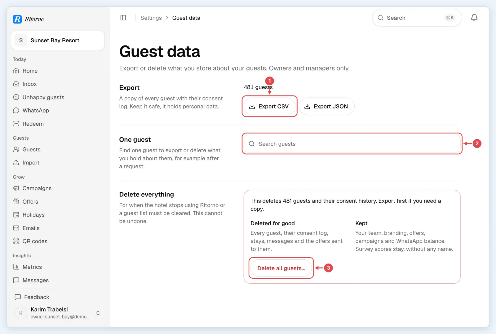
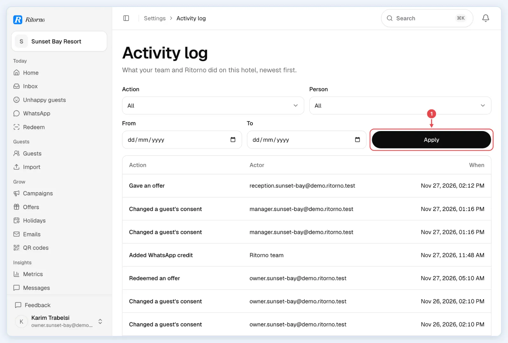

Managers can do these tasks too. Everything in the [manager](/docs/guide/manager) and [front desk](/docs/guide/front-desk) pages is yours.

## Set up a new hotel

On a new hotel, Home shows a short checklist. Each step ticks itself when it is done.

1. Select a step to go straight to the right page. Do them before guests start scanning.

## Hotel settings

Open **Settings**, then **Hotel**. Each part saves on its own.

1. **Logo**: PNG, JPEG or WebP, 1 MB at most.
2. Name, colors and the guest language used when we do not know the guest's own. The preview updates as you type.
3. **Reply-to email**: answers from guests arrive here. Also set your address and time zone.
4. **Send a test alert** to check that low score alerts reach you. They go to the reply-to address, or to an owner when none is set.
5. **Low score alert**: the score out of 10 at or below which you are warned. It starts at 6.
6. **Google review link**: after the survey, every guest is invited to share their review there, whatever their score.

The **weekly summary** switch emails owners the counts of the week every Monday, without guest details.

## Your team

Open **Settings**, then **Team**. Give each person their own account, never a shared one.

1. The email of the new colleague, with a role below it. See [who can do what](/docs/guide#who-can-do-what).
2. **Send invitation**.
3. **Copy link** if the email did not arrive, and pass the link to that person only.
4. **Send again**. **Revoke** cancels an invitation.
5. What each role can do.

Change a role with the list next to a name. When someone leaves, select **Remove** the same day: they lose access at once.

## WhatsApp balance

Email is free. WhatsApp messages are paid in advance. Open **Settings**, then **Usage**.

1. What is left. At zero, WhatsApp messages stop and email keeps going. Ask the Ritorno team to top up.
2. Every top-up, message and refund. A message that could not be delivered is refunded.

## Guest data requests

Your guests may ask for a copy of what you hold about them, or ask you to delete it. Open **Settings**, then **Guest data**.

1. **Export** every guest with their consent history, as CSV or JSON. The file holds personal data: store it safely and delete it when you are done.
2. **One guest**: search for the person to export or delete their data.
3. **Delete all guests** removes everyone for good and asks you to type the hotel name. There is no undo. Export first.

## Who did what

**Settings**, then **Activity log**, lists what your team and the Ritorno team did, newest first.

1. Filter by action, person or dates, then **Apply**.
