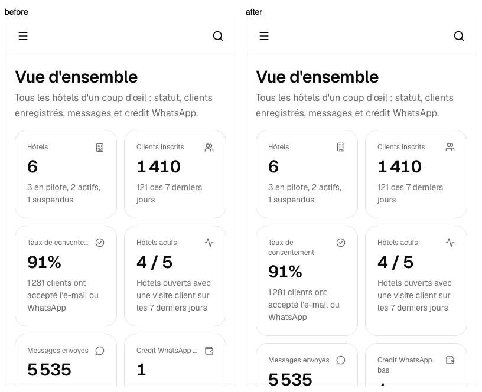
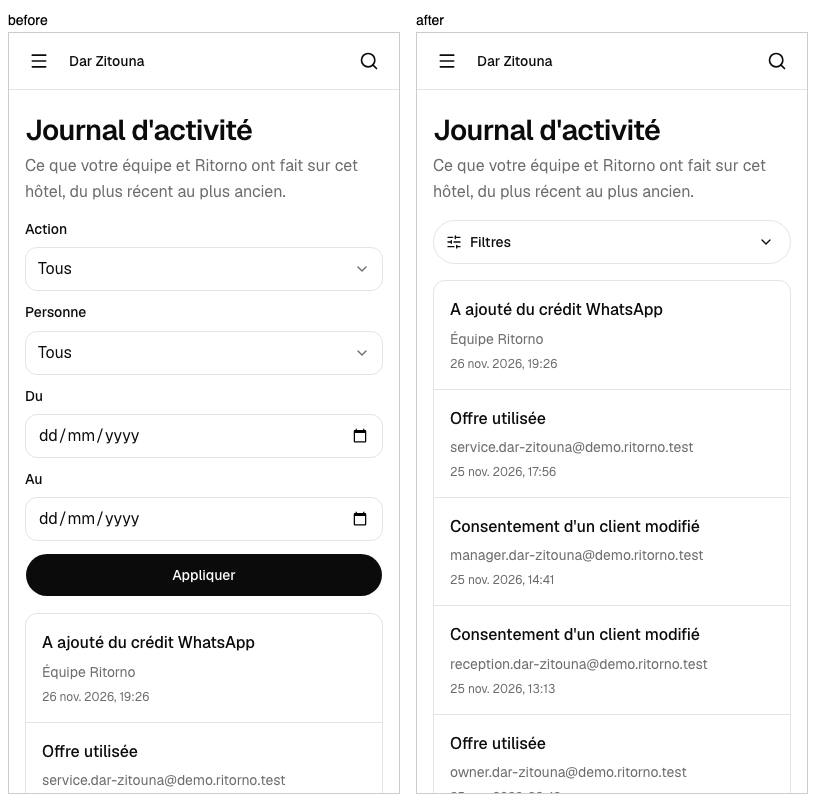
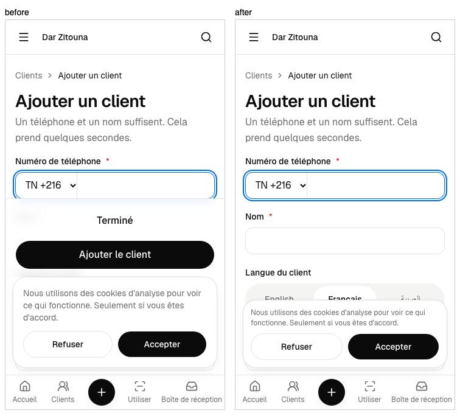
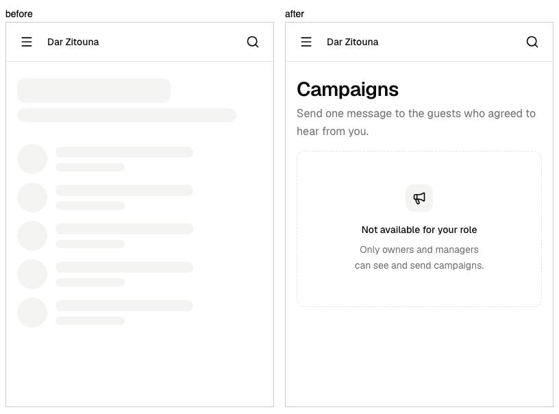
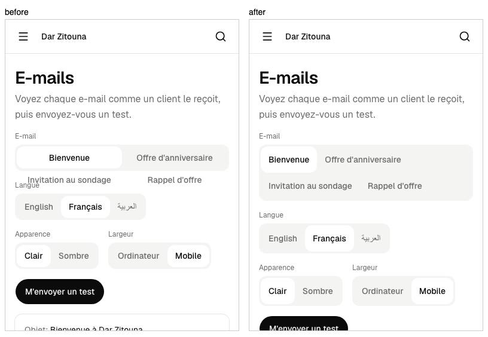
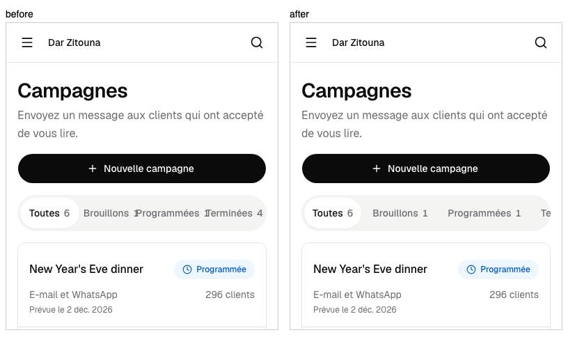

Every page of the web site, the dashboard (owner, staff, admin) and the guest pages, at 390 px and 1440 px, in en, fr and ar, on the seeded demo data with log only providers. Overflow, truncated text, touch targets and axe were checked by script, the screenshots by eye, and keyboard focus on the main pages.

## Fixed

### Platform overview cut the stat titles in French

`StatCard` labels now wrap.

### The activity filters filled the first phone screen

On a phone they start folded behind one button with the number of filters in use. Same for the admin audit log.

### The cookie card covered the form

The card is smaller on a phone, and sticky form actions stop sticking while it is open.

### Staff got a skeleton that never ended on campaigns and holidays

Both pages now say the role cannot use them.

### Email choices fell out of their group

### Campaign filters ran into each other in French

Segmented controls scroll instead of squeezing their labels.

### Smaller ones

- offer texts and guest comments written in another language keep their punctuation in Arabic
- the consent rows of a guest wrap instead of breaking "E-mail" in two
- the admin audit log dates follow the app language
- the status page, which is English only, is marked left to right
- guest filter chips used `aria-pressed` on links, now `aria-current`
- the red buttons are now above 4.5:1 contrast

## Still open

- the status page is not translated
- the small tab lists (hotel preview, QR codes, offer preview) are 37 px tall on touch, under the 44 px rule
- some text links in lists (guest names on home, hotel names for admins, breadcrumbs) are about 20 px tall
- axe still reports the sidebar and account buttons (visible text not in the accessible name), content outside landmarks and a few skipped heading levels
- the date fields of the activity filters show only the browser's own highlight on keyboard focus
- staff still see campaigns and holidays in the navigation, and `/campaigns/new` shows them the form
